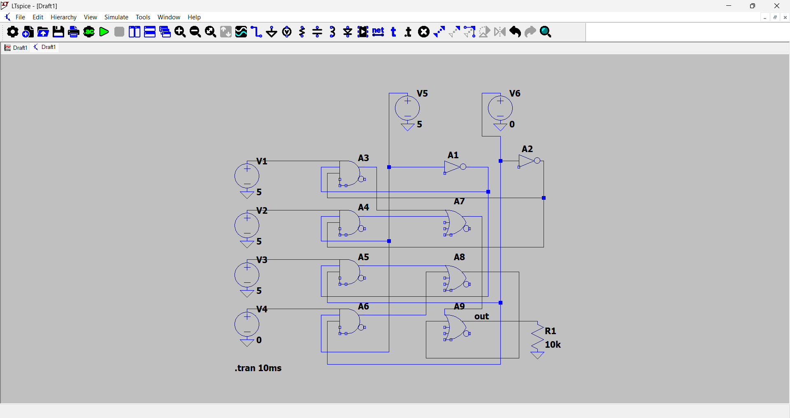
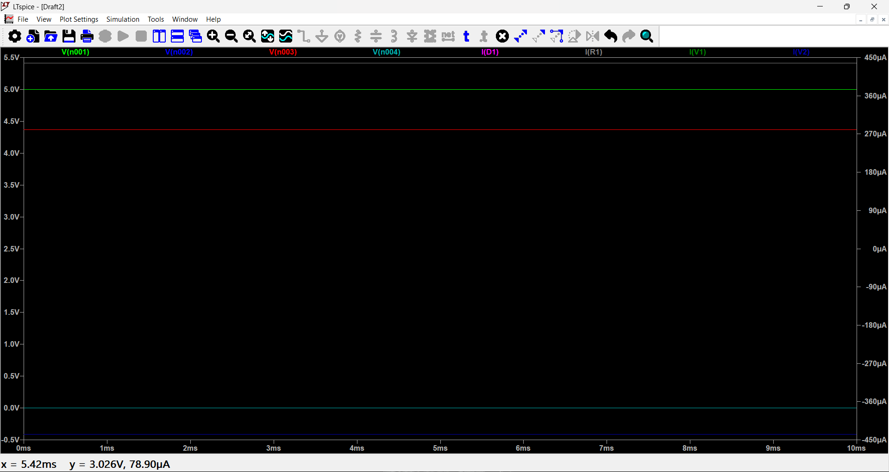

# ⚡ Multi-Channel Industrial Sensor Data Selector


-orange)


> 🌐 **Interactive Web Demo:** Test the logic states, switch channels, and view real-time transient waveforms directly in your browser:  
> 👉 **[Launch Live Simulator](https://abishal-afk.github.io/LTspice-digital-circuit-simulation/)**

A gate-level **4×1 combinational multiplexer** designed and simulated using **LTspice**. The project models an industrial telemetry data selector that aggregates multiple independent sensor signals (such as temperature, pressure, vibration, and liquid level) into a single shared monitoring line, significantly reducing microcontroller pin consumption, cabling complexity, and signal routing overhead.

---

## 📑 Full Project Documentation
The complete theoretical analysis, truth tables, and industrial case study are documented in the 15-page academic report:
- 📖 **[View Project Report (PDF)](./Multi-Channel-Industrial-Sensor-Data-Selector.pdf)**

---

## 📌 Circuit Schematic

The circuit implements a 4-to-1 data multiplexing topology built directly with fundamental digital logic components:



### ⚙️ Hardware & Gate Architecture
* **Input Channels ($V_1$ to $V_4$):** Four DC voltage sources representing field sensor signals.
* **Control / Address Lines ($V_5 = S_0$, $V_6 = S_1$):** Binary address lines controlling channel routing.
* **Gate Array:**
  * **Inverters ($A_1, A_2$):** Generate complementary select states ($\overline{S_0}, \overline{S_1}$).
  * **3-Input AND Gates ($A_3$ to $A_6$):** Decode channel address combinations.
  * **Cascaded OR Stages ($A_7$ to $A_9$):** Funnel the enabled sensor channel directly to node `out`.
* **Output Stabilization ($R_1 = 10\text{ k}\Omega$):** Output pull-down resistor eliminating high-impedance floating node issues (`nV` scale anomalies) and stabilizing logic states.

---

## 🧠 Boolean Logic & Channel Selection Matrix

The output voltage follows the Boolean expression:

$$Out = (V_1 \cdot \overline{S_1} \cdot \overline{S_0}) + (V_2 \cdot \overline{S_1} \cdot S_0) + (V_3 \cdot S_1 \cdot \overline{S_0}) + (V_4 \cdot S_1 \cdot S_0)$$

| Select $S_1$ ($V_6$) | Select $S_0$ ($V_5$) | Selected Sensor Channel | Output State (`out`) |
| :---: | :---: | :---: | :---: |
| **0 (0 V)** | **0 (0 V)** | Channel 1 ($V_1$) | $V_1$ |
| **0 (0 V)** | **1 (5 V)** | Channel 2 ($V_2$) | $V_2$ |
| **1 (5 V)** | **0 (0 V)** | Channel 3 ($V_3$) | $V_3$ |
| **1 (5 V)** | **1 (5 V)** | Channel 4 ($V_4$) | $V_4$ |

---

## 📊 Transient Simulation Results

* **Simulation Directive:** `.tran 10ms`
* **Analysis:** Transient sweep confirming stable DC signal transmission without oscillation or attenuation across the active channel.



---

## 🛠️ How to Replicate Simulation

1. Download and install **[LTspice](https://www.analog.com/en/resources/design-tools-and-calculators/ltspice-simulator.html)**.
2. Clone or download this repository:
   ```bash
   git clone [https://github.com/Abishal-afk/LTspice-digital-circuit-simulation.git](https://github.com/Abishal-afk/LTspice-digital-circuit-simulation.git)
